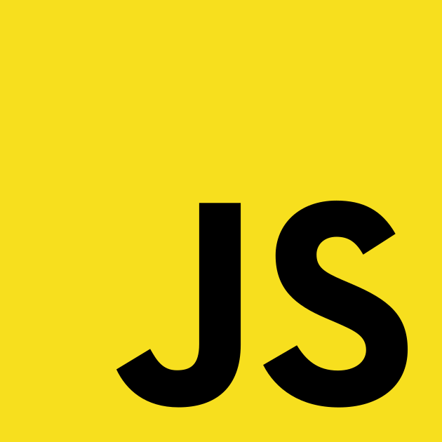
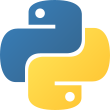
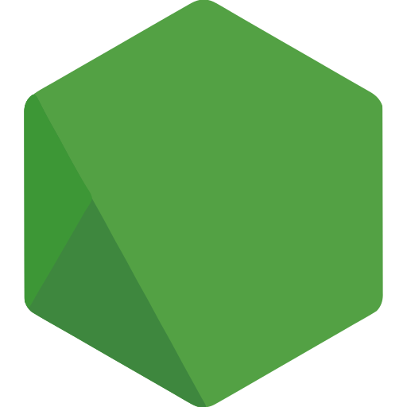
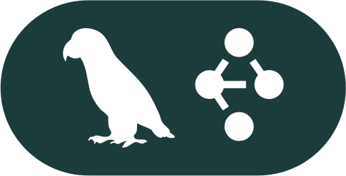
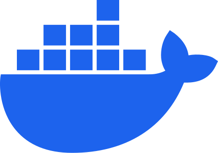
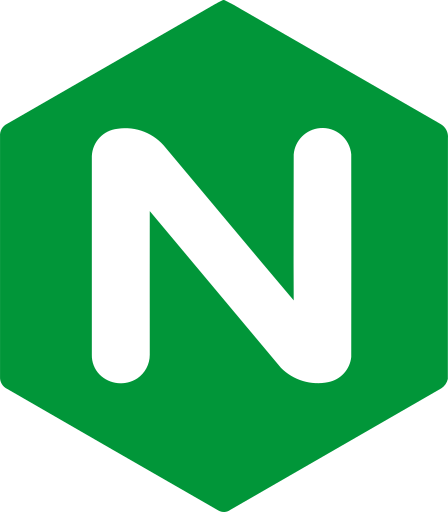

# Hi there, I'm Abrar Yeasir 👋

### Software Engineer | Full-Stack & AI Systems

 

📍 **Chattogram, Bangladesh** &nbsp;|&nbsp; 🎓 **Premier University (B.Sc. in CSE, 6th Sem)** &nbsp;|&nbsp; 📞 **+880 1860700650**

---

### 📌 About Me

Full-stack software engineer and Computer Science undergraduate specializing in backend architecture, high-performance APIs, and AI-integrated systems. I build production-grade web applications and autonomous agentic workflows that bridge complex business logic with clean system design. Passionate about turning robust backend infrastructure and innovative AI concepts into real-world software solutions.

---

### 💻 Technical Stack

#### 🌐 Languages

   <b>JavaScript (ES6+)</b> &nbsp;&nbsp;&bull;&nbsp;&nbsp;
   <b>TypeScript</b> &nbsp;&nbsp;&bull;&nbsp;&nbsp;
   <b>Python</b> &nbsp;&nbsp;&bull;&nbsp;&nbsp;
   <b>SQL</b>

#### 🧠 Backend & AI Systems

   <b>Node.js</b> &nbsp;&nbsp;&bull;&nbsp;&nbsp;
   <b>Bun</b> &nbsp;&nbsp;&bull;&nbsp;&nbsp;
   <b>Express.js</b> &nbsp;&nbsp;&bull;&nbsp;&nbsp;
   <b>LangGraph.js</b> &nbsp;&nbsp;&bull;&nbsp;&nbsp;
   <b>Gemini API</b> &nbsp;&nbsp;&bull;&nbsp;&nbsp;
   <b>Autonomous Agents</b> &nbsp;&nbsp;&bull;&nbsp;&nbsp;
   <b>RAG</b> &nbsp;&nbsp;&bull;&nbsp;&nbsp;
   <b>Vector DB</b> &nbsp;&nbsp;&bull;&nbsp;&nbsp;
   <b>PostgreSQL</b> &nbsp;&nbsp;&bull;&nbsp;&nbsp;
   <b>Redis</b> &nbsp;&nbsp;&bull;&nbsp;&nbsp;
   <b>Prisma ORM</b> &nbsp;&nbsp;&bull;&nbsp;&nbsp;
   <b>Inngest</b>

#### 🎨 Frontend & Mobile

   <b>React.js</b> &nbsp;&nbsp;&bull;&nbsp;&nbsp;
   <b>Next.js (App Router)</b> &nbsp;&nbsp;&bull;&nbsp;&nbsp;
   <b>React Native</b> &nbsp;&nbsp;&bull;&nbsp;&nbsp;
  <b>Expo</b> &nbsp;&nbsp;&bull;&nbsp;&nbsp;
   <b>Tailwind CSS</b> &nbsp;&nbsp;&bull;&nbsp;&nbsp;
   <b>TanStack Query</b> &nbsp;&nbsp;&bull;&nbsp;&nbsp;
   <b>Motion</b>

#### 🚀 DevOps, Cloud & Tools

   <b>Docker</b> &nbsp;&nbsp;&bull;&nbsp;&nbsp;
   <b>Git</b> &nbsp;&nbsp;&bull;&nbsp;&nbsp;
   <b>GitHub Actions</b> &nbsp;&nbsp;&bull;&nbsp;&nbsp;
   <b>Postman</b> &nbsp;&nbsp;&bull;&nbsp;&nbsp;
   <b>Linux</b> &nbsp;&nbsp;&bull;&nbsp;&nbsp;
   <b>Supabase</b> &nbsp;&nbsp;&bull;&nbsp;&nbsp;
   <b>Upstash</b> &nbsp;&nbsp;&bull;&nbsp;&nbsp;
   <b>Nginx</b> &nbsp;&nbsp;&bull;&nbsp;&nbsp;
   <b>Cloudflare</b> &nbsp;&nbsp;&bull;&nbsp;&nbsp;
   <b>Stripe</b>

---

### 🏆 Projects & Engineering Experience

#### 🏢 Full-Stack Coaching Center Management System

- **Scalable Operations Platform:** Architected a full-scale institutional operations platform featuring 93 REST endpoints, strict schema validation, multi-persona RBAC (Admin, Teacher, Student), and a 7-day collision-free routine scheduling matrix.
- **In-Memory Streaming Document Engine:** Developed a zero-cloud in-memory streaming document engine using `PDFKit` that dynamically synthesizes official invoices and grade cards in under 15ms.
- **Dual-Channel Financial Pipeline:** Integrated a dual-channel financial pipeline combining Stripe Checkout sessions with automated local mobile financial services (bKash/Nagad) and Redis OTP state management.

`Next.js` • `React` • `Node.js` • `Express.js` • `PostgreSQL` • `Prisma ORM` • `Redis` • `Stripe` • `Docker`

---

#### 🤖 CashPilot AI – Autonomous SME Financial Intelligence

- **Autonomous Financial Operating System:** Engineered an autonomous agentic financial operating system with deterministic mathematical safety, executing 30-day rolling cash runway forecasts and aggregations exclusively in TypeScript and PostgreSQL to prevent LLM calculation drift.
- **Multi-Tool Cyclical State Machine:** Architected a cyclical multi-tool agent state machine using `LangGraph.js` and `Gemini 3.5 Flash` bound to 8 backend tools with automated failover to Groq Llama 3.3.
- **Omni-Channel Telegram Integration:** Built an omni-channel Telegram bot (`@cash_pilot_ai_bot`) delivering sub-3-second receipt and invoice OCR parsing, syncing in real-time with the Next.js 16 web management console.

`Next.js 16` • `LangGraph.js` • `Gemini API` • `Bun` • `Prisma` • `PostgreSQL` • `Redis` • `Inngest`

---

### 🎖️ Honors & Achievements

- 🥇 **1st Runner Up – ICT Olympiad Bangladesh (2023):** Secured national placement in a prestigious competitive technology Olympiad, demonstrating algorithmic problem-solving and rapid debugging capabilities.

---

### 🎓 Education

- **Premier University** — Chattogram, Bangladesh  
  **B.Sc. in Computer Science and Engineering** | _Current Student (6th Semester)_

---

### 📬 Get In Touch

- 🌐 **Portfolio:** [abraryeasir.vercel.app](https://abraryeasir.vercel.app)
- 💼 **LinkedIn:** [linkedin.com/in/iamabraryeasir](https://www.linkedin.com/in/iamabraryeasir/)
- 🐙 **GitHub:** [github.com/iamabraryeasir](https://github.com/iamabraryeasir)
- 📧 **Email:** [iamabraryeasir@gmail.com](mailto:iamabraryeasir@gmail.com)
- 📱 **Phone / WhatsApp:** [+880 1860700650](https://wa.me/8801860700650)
- 📍 **Location:** Chattogram, Bangladesh
